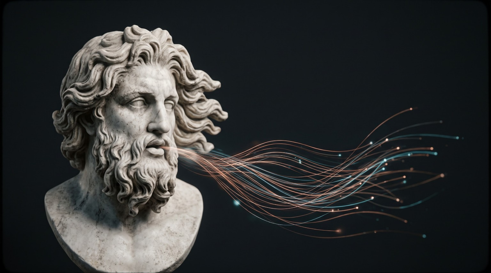

<p align="center">
  
</p>

<h1 align="center">EURUS</h1>

<p align="center">
  <strong>Autonomous AI Agent</strong><br>
  A foundation for general-purpose autonomous AI workflows.
</p>

<p align="center">
  <a href="#about">About</a> ·
  <a href="#visual-identity">Visual identity</a> ·
  <a href="#development">Development</a>
</p>

---

## About

**EURUS** is a general-purpose autonomous AI agent project. This repository contains the codebase and supporting resources for the project.

The name draws inspiration from Eurus, the Greek personification of the east wind—a fitting symbol for an agent built to move work forward.

## Visual identity

<p align="center">
  
</p>

<p align="center">
  
</p>

The visual direction combines classical marble sculpture with fine copper and cyan light trails, representing the meeting of enduring foundations and modern intelligence.

## Development

Run these checks from the repository root when the corresponding tools and dependencies are installed:

```bash
ruff check src tests
mypy src
python -m pytest -v -p no:cacheprovider
```

## Project structure

```text
.
├── .github/
│   └── asset/
│       ├── eurus-banner.jpg
│       ├── eurus-wordmark.jpg
│       └── eurus-visual.jpg
├── src/
└── tests/
```

---

<p align="center">
  <sub>EURUS · Autonomous AI Agent</sub>
</p>
